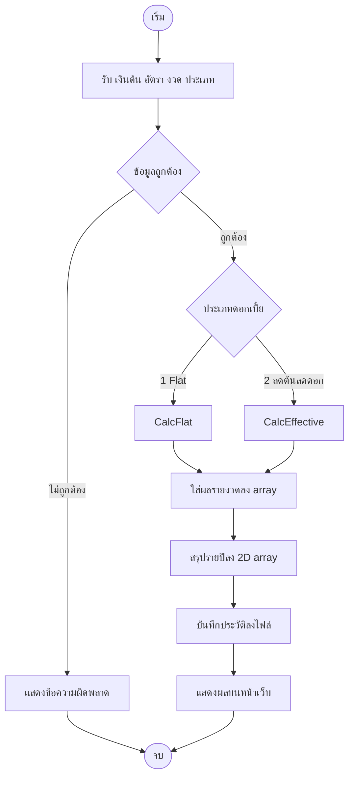

# การวิเคราะห์ปัญหาและอัลกอริทึม (Problem Solving & Algorithm)

## 1. วิเคราะห์ปัญหา

**ปัญหา:** คนที่กู้เงินมักดูแค่ค่างวดต่อเดือน แต่ไม่รู้ว่าสุดท้ายจ่ายดอกเบี้ยรวมเท่าไร และดอกเบี้ยแบบ Flat กับลดต้นลดดอกต่างกันอย่างไร

| ส่วน | รายละเอียด |
|---|---|
| Input | เงินต้น, ดอกเบี้ยต่อปี (%), จำนวนงวด (เดือน), ประเภทดอกเบี้ย (1 = Flat, 2 = ลดต้นลดดอก), ยอดจ่ายเพิ่มต่อเดือน (ไม่บังคับ) |
| Process | ตรวจข้อมูล, เลือกสูตร, คำนวณค่างวดและตารางรายงวดเก็บใน array, สรุปรายปี (2D array), จำลองจ่ายเพิ่ม, บันทึกประวัติลงไฟล์ |
| Output | ค่างวด, ดอกเบี้ยรวม, ยอดจ่ายทั้งหมด, ตารางผ่อนชำระ, สรุปรายปี, ประวัติ, ไฟล์ CSV |

## 2. อัลกอริทึม (Pseudocode)

```
START
  รับค่า เงินต้น, อัตรา, งวด, ประเภท
  IF ข้อมูลไม่ถูกต้อง THEN
      แสดงข้อความผิดพลาด; END
  SWITCH ประเภท
      CASE 1 (Flat):
          ดอกเบี้ยรวม = เงินต้น x อัตรา x (งวด / 12)
          ค่างวด = (เงินต้น + ดอกเบี้ยรวม) / งวด
          FOR i = 1 TO งวด
              ดอกเบี้ย[i] = ดอกเบี้ยรวม / งวด
              เงินต้น[i]  = เงินต้น / งวด
              คงเหลือ[i]  = คงเหลือก่อนหน้า - เงินต้น[i]
      CASE 2 (ลดต้นลดดอก):
          r = อัตรา / 12 / 100
          ค่างวด = P x r / (1 - (1 + r)^-n)
          FOR i = 1 TO งวด
              ดอกเบี้ย[i] = คงเหลือก่อนหน้า x r
              เงินต้น[i]  = ค่างวด - ดอกเบี้ย[i]
              คงเหลือ[i]  = คงเหลือก่อนหน้า - เงินต้น[i]
  สรุปรายปีลง 2D array (วนทีละปี แล้ววนทีละเดือน)
  บันทึกประวัติลงไฟล์ history.txt
  แสดงผล
END
```

## 3. Flowchart



## 4. การแตกปัญหาเป็นโมดูล

| โมดูล | แก้ปัญหาย่อยอะไร |
|---|---|
| `LoanValidator` | ตรวจว่าข้อมูลที่กรอกใช้ได้ไหม |
| `LoanCalculator` | เลือกสูตรและคำนวณตารางรายงวด |
| `LoanAnalyzer` | สรุปรายปี, จำลองจ่ายเพิ่ม, หาดอกเบี้ยจริง |
| `FileService` | เขียน/อ่านประวัติ และสร้าง CSV |
| `IndexModel` | รวมทุกโมดูลเข้าด้วยกัน (Integration) |
